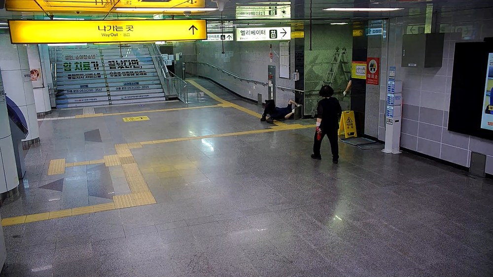
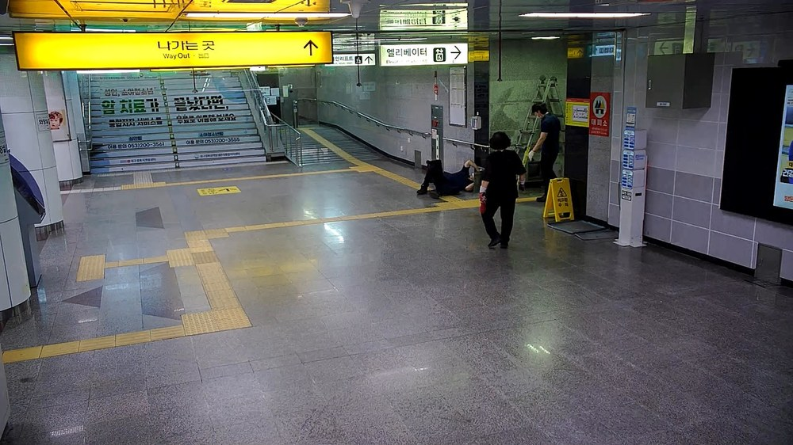
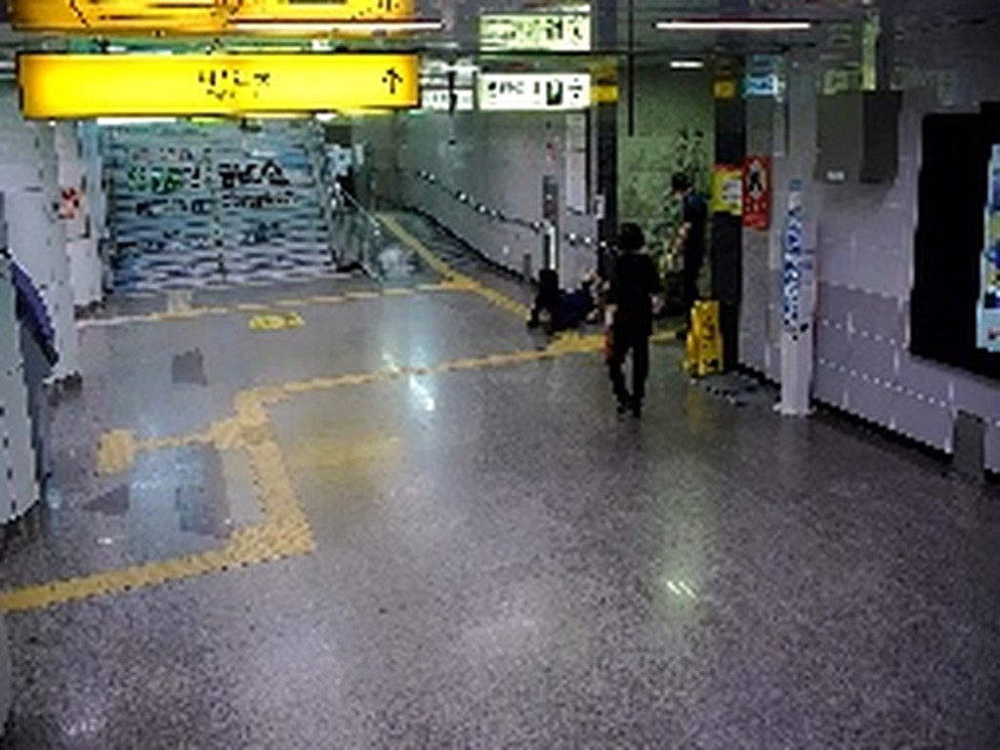
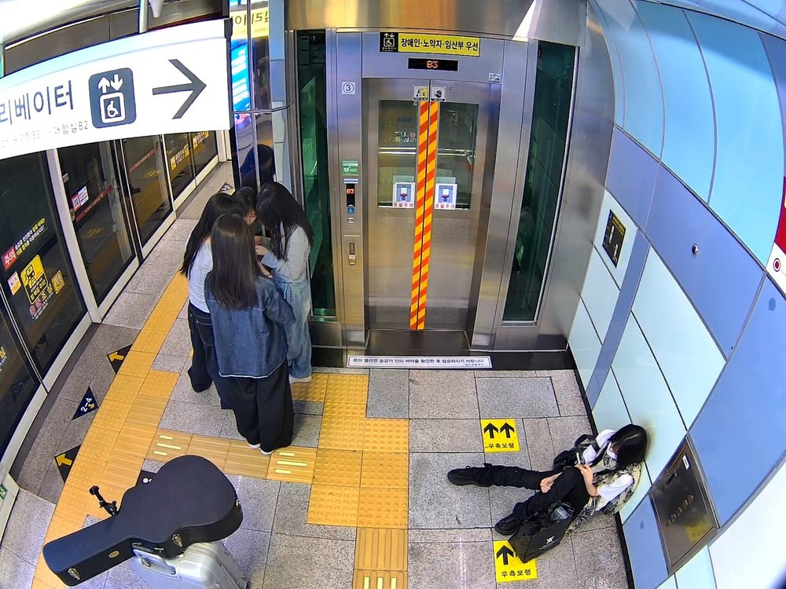
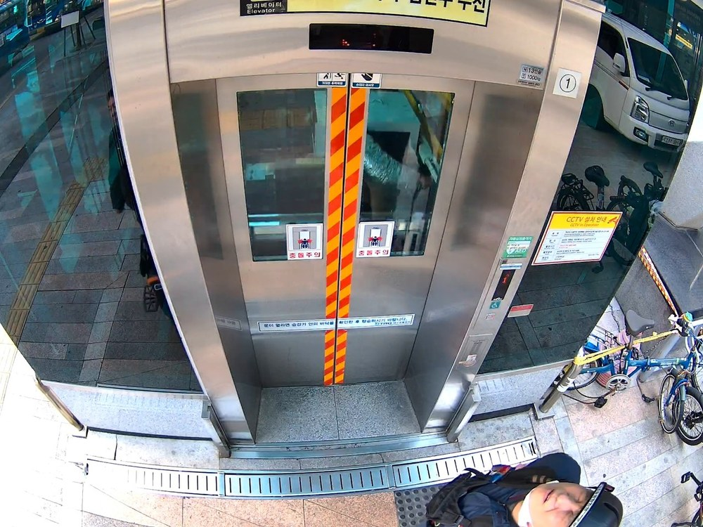
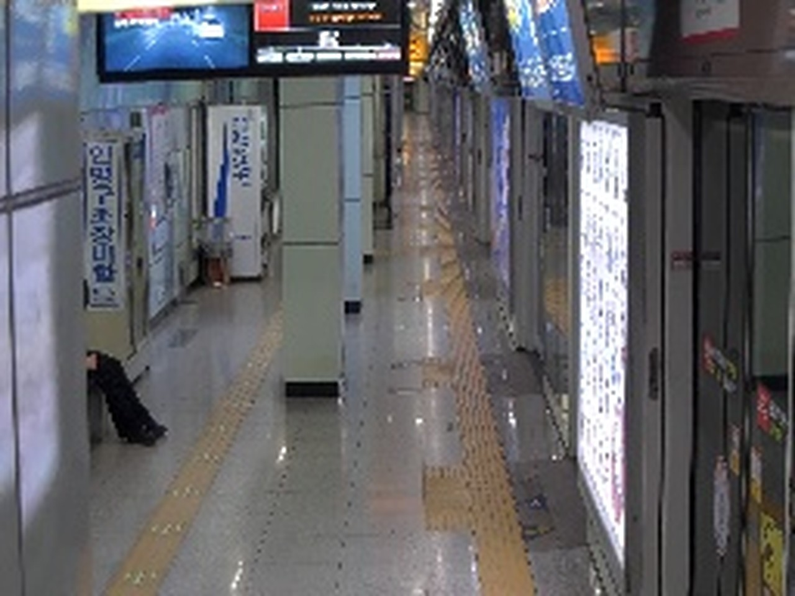
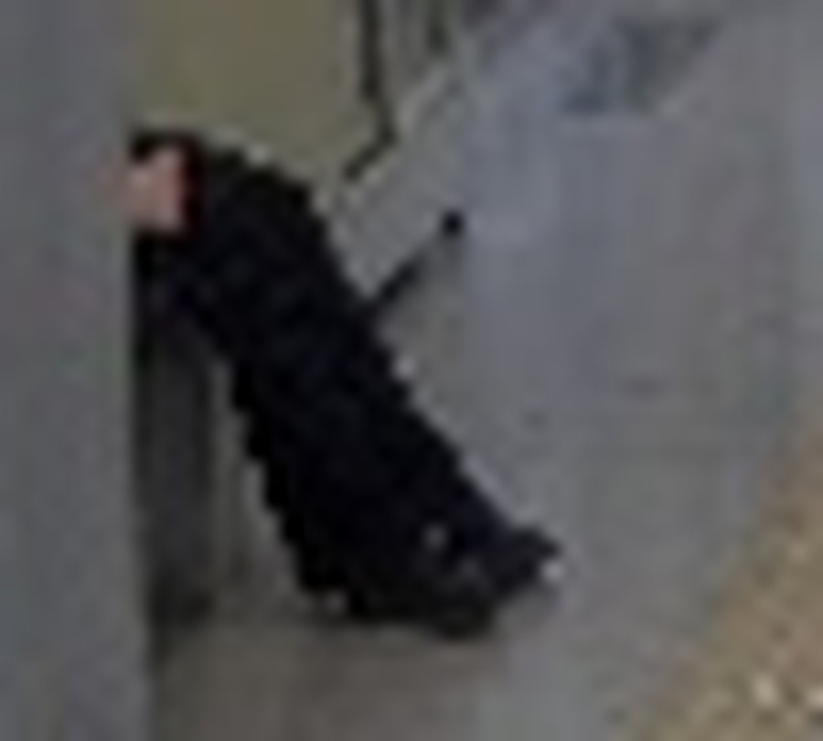

# 실증 전 24시간 테스트 — 정탐/오탐 판정 결과

> ## ⚠ 정정 고지 (2026-10-13)
>
> **본 문서의 집계는 별첨 `1차추론기 결과.zip` 범위(100건) 기준이며, 시험 구간 전체가 아님.**
> zip 은 수집이 시험 개시 37분 후(10-12 20:32)부터 이루어져 **102건 중 100건만** 수록되어 있음.
> 미수록 2건: `10-12 19:55:33 카메라 837(통과)`, `10-12 19:58:49 카메라 842(기각)`.
>
> | 항목 | 본 문서(zip 기준) | **정정(24h 전수)** |
> |---|---:|---:|
> | 1차 → 2차 전달 | 100건 | **102건** |
> | 2차 통과 | 7건 | **8건** |
> | 2차 기각 | 93건 | **94건** |
> | 차단율 | 93.0% | **92.2%** |
>
> 2차 통과 8건이 최종 쓰러짐 알람 8건과 일치함.
> **확정 수치는 `실증전_24h_에이징_시험_결과보고.pdf` 를 따를 것.**


**범위는 이 폴더 안의 두 파일뿐이다.**

| 파일 | 내용 |
|---|---|
| `1차추론기 결과.zip` | 1차 후보 **100건** (falldown_ret) — 각 건에 `verdict.json`(2차 판정) + 썸네일 256×192 |
| `30.60_이벤트_24h_20261012-1013.csv` | 최종 이벤트 **13건** |

> 서버 MinIO 에는 이 밖에도 1차 후보가 더 있지만(fire·smoke·시험구간 밖 포함) **이 문서의 집계에는 넣지 않았다.**
> 고해상도 원본 이미지는 위 CSV 에 적힌 `thumbnail_minio_url` 이 가리키는 바로 그 파일만 **판정 근거로** 가져다 썼다.

시험 구간 **2026-10-12 19:55:33 ~ 10-13 19:56:48** (24시간 01분), 중앙로역 62채널.

---

## 1. 최종 알람은 어떤 카테고리로 울렸나

CSV 13건의 전부다.

| 카테고리 | 건수 | 2차 VQA 검증 | 비고 |
|---|---:|---|---|
| **falldown** | **8** | **받음** | 본 문서의 판정 대상 |
| **intrusion_npu** | **5** | 받지 않음 | 설계상 1차(사람검출)로 종료 — 판정 대상에서 제외 |

**울린 카테고리는 이 두 가지뿐이다.** `fire / smoke / smoking / esfalldown / elvfalldown / climbingup` 은 24시간 동안 최종 알람이 0건이었다.

### falldown 8건 — 카메라별

| 카메라 | 카메라명 | 건수 |
|---|---|---:|
| 819 | dtro_42 상선_승강장_EV3 | 4 |
| 814 | dtro_48 시점_지상부_EV1 | 2 |
| 837 | dtro_03 1코너_회전 | 2 |

---

## 2. 정탐 — **2건**

```
최종 알람 falldown 8건
  ├─ 정탐  2건   (cam 837)
  └─ 오탐  6건   (cam 819 × 4, cam 814 × 2)
```

**정탐 2건은 모두 cam 837 `dtro_03 1코너_회전` 에서 나왔고, 같은 장소·같은 상황이다.**

### 정탐 ① event_id `1172442` — 2026-10-12 19:55:33 · cam 837



계단 아래 **사람이 바닥에 누워 있고**, 그 옆에 사람이 서서 지켜보고 있다. 노란 안전표지와 사다리가 보인다.
누운 자세가 명확하고 주변인이 반응하고 있어 **정탐으로 판정**한다.

> ★ 이 건은 **zip 에 없다.** zip 의 1차 로그는 20:32:30 부터 시작해 앞의 37분이 빠져 있다.
> 판정은 CSV `thumbnail_minio_url` 의 원본(1920×1080)으로 했다.

### 정탐 ② event_id `1172612` — 2026-10-13 19:55:06 · cam 837



**①과 동일한 장면**이다. 누운 사람, 옆에 선 사람, 같은 안전표지·사다리까지 같다. 인물 위치만 조금 다르다.

2차가 받은 1차 썸네일(256×192, 4배 확대):



> ★ **두 건은 23시간 59분 33초 차이**인데 장면이 사실상 같다. 24시간 영상의 시작과 끝 경계라,
> **같은 구간이 두 번 처리됐을 가능성**이 있다. 그렇다면 실제 쓰러짐 사건은 **1건**이고 정탐이 중복 집계된 것이다.
> 소스 영상 구간을 확인해야 확정된다.

---

## 3. 오탐 — 6건

| event_id | cam | 시각 | 실제 장면 |
|---|---|---|---|
| 1172584 / 1172585 / 1172586 / 1172587 | 819 | 10-13 08:44:34 ~ 08:45:49 | 벽에 기대 **바닥에 앉아 휴대폰 보는 사람** |
| 1172527 | 814 | 10-13 03:01:25 | 어안 카메라 **바로 아래를 지나가는 보행자** |
| 1172608 | 814 | 10-13 19:13:27 | 위와 동일 |

### cam 819 — 바닥에 앉은 사람 (4건)



우하단에 **벽에 등을 대고 바닥에 앉아 휴대폰을 보는 사람**이 있다. 다리를 뻗고 있어 저해상도에서는 누운 것처럼 보인다.
운영 프롬프트가 *"sitting (including sitting on the ground)" = `no`* 라고 **명시**한 자세다.

12초 간격으로 4건이 연속 발화했고, 그 사이 08:45:11 한 건은 **기각**됐다. 같은 사람·같은 자세인데 판정이 뒤집힌다.

### cam 814 — 카메라 바로 아래 보행자 (2건)



엘리베이터 **바로 위**에 달린 어안 카메라라, 밑을 지나는 사람은 몸통이 프레임 밖으로 잘리고 머리·어깨만 가로로 눌려 보인다.
모자 쓰고 지나가는 사람인데 수평 형상이 된다.

---

## 4. 1차는 잡았는데 2차가 거절한 건 (2차 미탐)

**93건의 기각 전부를 장면 단위로 확인했다.** 100건을 dHash 로 묶으니 **14개 장면**이 나왔고, 전 장면을 확대해 봤다.

| 장면 | cam | 건수 | 2차 | 실제 장면 | 판정 |
|---|---|---:|---|---|---|
| A | 826 | 74 | 기각 74 | 대합실 탁자에 **앉아 엎드린 사람** | 오탐 |
| B | 814 | 5 | 통과 2 / 기각 3 | 어안 하단 보행자 | 오탐 |
| C | 819 | 5 | 통과 4 / 기각 1 | 바닥에 앉아 휴대폰 | 오탐 |
| D | 844 | 4 | 기각 4 | 원경 벤치에 앉은 무리 | 오탐 |
| E | 860 | 2 | 기각 2 | 게이트 원경 보행자 | 오탐 |
| F | 827 | 2 | 기각 2 | 승강장 벤치에 앉은 2인 | 오탐 |
| G | 836 | 1 | 기각 | 하단 가장자리 보행자 | 오탐 |
| H | 854 | 1 | 기각 | **계단에 앉은 2인** | 오탐 |
| I | 819 | 1 | 기각 | 하단 가장자리 보행자 | 오탐 |
| J | 850 | 1 | 기각 | 하단 가장자리 보행자 | 오탐 |
| K | 844 | 1 | 기각 | 원경 인물 | 오탐 |
| **L** | **825** | **1** | **기각** | **벽에 기대 바닥에 있는 사람** | **의심 — 확인 필요** |
| M | 837 | 1 | 통과 1 | 바닥에 누운 사람 + 주변인 | **정탐** |
| N | 842 | 1 | 기각 | 하단 가장자리 보행자 | 오탐 |

### 결론 — 확정된 2차 미탐은 **0건**, 의심 **1건**

기각 93건 중 **명백한 쓰러짐은 없었다.** 대부분 앉은 자세이거나 어안 카메라 하단에서 잘린 보행자다.
다만 한 건이 걸린다.

### 의심 — cam 825 `dtro_41 본선3중앙선로_11K 548` · 2026-10-13 15:16:59 · **2차 기각**



좌측 벽 아래에 사람이 있다. 확대하면:



**머리를 벽에 대고 다리를 뻗은 채 바닥에 있다.** 상체가 비스듬해서 "벽에 기대 앉음"으로도, "쓰러져 기댐"으로도 읽힌다.
프롬프트 규칙("sitting on the ground = no")대로면 기각이 맞지만, **운영 관점에서는 확인이 필요한 자세**다.

이 건은 2차에서 기각돼 이벤트가 생성되지 않았으므로 **영상·고해상도 썸네일이 없다.** 256×192 로는 확정이 불가능하다.

---

## 5. 요약

| 항목 | 값 |
|---|---:|
| 1차 후보 (zip) | **100건** — 전부 falldown |
| 2차 통과 | 7건 |
| 2차 기각 | 93건 |
| 최종 알람 (CSV) | **13건** = falldown 8 + intrusion_npu 5 |
| **falldown 정탐** | **2건** (중복 가능성 있어 실질 1건일 수 있음) |
| **falldown 오탐** | **6건** |
| **2차 미탐 (1차 정탐 → 2차 기각)** | **확정 0건 / 의심 1건** (cam 825) |

**2차 게이트는 제 역할을 했다.** 1차 후보 100건 중 실제 쓰러짐은 1~2건뿐이었고, 2차가 93건을 걸러내면서 **진짜 쓰러짐은 통과시켰다.**
놓친 것으로 의심되는 건 cam 825 한 건이고, 그마저도 확정이 아니다.

**남은 문제는 오탐 6건이다.** 전부 두 가지 자세에서 나왔다 — ①바닥에 앉은 사람(819) ②어안 카메라 하단에 잘린 보행자(814).
둘 다 프롬프트가 이미 `no` 로 규정한 자세이므로, 문안 수정이 아니라 **ROI 조정**이 맞는 대책이다.

### 판정 근거의 한계

- 1차 썸네일은 원본도 **256×192** 다. 이 해상도로는 **앉은 자세와 누운 자세가 구분되지 않는다.** 실제로 저해상도만 보고 내린 1차 판정이 고해상도 확인에서 두 번 뒤집혔다.
- 2차 VLM 도 **같은 256×192 를 받는다.** 819 오탐 4건의 원인이 프롬프트가 아니라 **입력 해상도**일 가능성이 크다.
- 기각된 93건은 이벤트가 안 생겨 고해상도 자료가 없다. **2차 미탐 "확정 0건" 은 저해상도 기준의 판정**이다.
